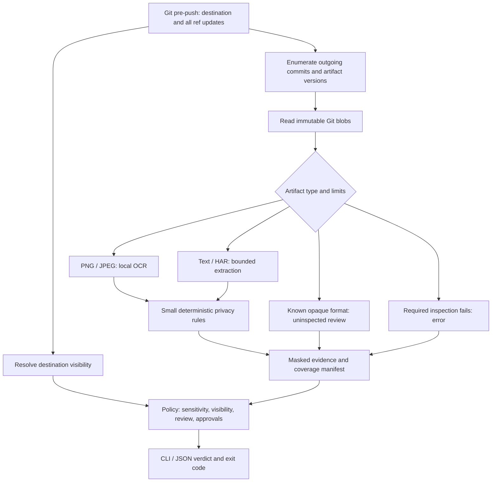

# AgentSafe — Architecture Draft

**Status:** Proposed design, October 5, 2026. Implement only after the user explicitly approves the document set.  
**Scope authority:** PRODUCT.md. Names, limits and package choices below are proposals, not working interfaces.

**Second-pass review:** [PRODUCT.md](PRODUCT.md#second-pass-review--october-5-2026) challenges the blanket image-review default, breadth of the first release and the assumption that Git push is the correct interception point. Treat this architecture as the original Git-gate option pending those decisions; do not implement its detailed mechanisms as accepted requirements.

## 1. Design decision

Use one Python CLI process, the installed Git executable, and local OCR. Keep modules inside one package. Do not build services, an agent proxy, a plugin framework, or a generic DLP engine.

The difficult parts are selecting the correct committed versions, communicating incomplete coverage, and binding review decisions to exact content. Detector count is not the primary architectural goal.



## 2. Recommended stack

| Concern | Recommendation | Reason / trade-off |
| --- | --- | --- |
| Runtime | Python 3.11+; pin supported minor versions at implementation time | Fast iteration and useful image-processing ecosystem; not a self-contained executable |
| CLI | [Typer](https://github.com/fastapi/typer) | Small typed command layer |
| Terminal output | [Rich](https://github.com/Textualize/rich), plus plain-text mode | Readable evidence and progress; JSON must bypass terminal formatting |
| Git | `git` subprocesses with argument arrays | Inspect actual object/ref semantics; no GitPython dependency needed |
| Image decode | Pillow, PNG/JPEG-only dispatch initially | Enforce decoded-pixel limits and avoid unsupported-format claims |
| OCR | Tesseract 5 with English data, via [pytesseract](https://github.com/madmaze/pytesseract) | Runs locally; external executable and language data must be installed |
| OCR evidence | TSV word boxes and confidence | Supports location-based inspection; [Tesseract TSV format](https://tesseract-ocr.github.io/tessdoc/Command-Line-Usage.html) |
| Text/HAR | Python UTF-8, `json`, small regex/URL parsers | Narrow deterministic rules without an NLP model |
| Visibility | Read-only GitHub.com metadata using stdlib HTTP; optional authenticated `gh api` | No AgentSafe account or stored token; public repositories need no authentication when the API is available |
| Config | `.agentsafe.toml`, parsed with `tomllib` | One explicit format, no configuration framework |
| Findings | Dataclasses and versioned JSON serialization | Shared terminal/JSON semantics without an extra validation framework |
| Local state | Atomic JSON manifests, approvals and bounded cache under the Git directory | No database/daemon; no raw artifacts in reports |
| Packaging | Standard `pyproject.toml`; pipx or uv tool installation after naming approval | Publish only under a verified project-owned distribution name |
| Verification | pytest for Git scenarios/detectors/CLI; Ruff and a selected type checker | Tests should demonstrate publishing behavior and coverage, not mirror functions |

Tesseract is a real installation cost. macOS/Linux are the proposed stable launch tiers; Windows with Git for Windows is experimental until setup, hook invocation, executable paths and Unicode filenames are tested on a clean machine. Python support alone does not establish cross-platform OCR support. [OCR installation guidance](https://tesseract-ocr.github.io/tessdoc/Installation.html).

**Alternatives:** Go gives easier CLI distribution but still needs an OCR engine or native bindings; Rust provides strong low-level control at higher integration cost for this MVP. An embedded ONNX OCR backend may eventually simplify installation, but adds model packaging, runtime, quality and license work. Choose it only after the setup experiment shows Tesseract is the wrong trade-off. Presidio/NER is unnecessary for the first few rules.

## 3. Proposed repository structure

Only the five root Markdown drafts exist during review. The following is a future layout, not an instruction to create code now.

```text
agentsafe/
├── README.md
├── PRODUCT.md
├── ROADMAP.md
├── ARCHITECTURE.md
├── AGENTS.md
├── LICENSE                         # after license approval
├── SECURITY.md                     # disclosure process, before public launch
├── pyproject.toml
├── src/agentsafe/
│   ├── __init__.py
│   ├── cli.py                      # command parsing and orchestration
│   ├── models.py                   # artifact, evidence, coverage, verdict
│   ├── config.py
│   ├── git_scope.py                # updates, commits, paths and blobs
│   ├── visibility.py               # destination identity and metadata
│   ├── artifacts.py                # selection, type routing and limits
│   ├── extractors/
│   │   ├── image.py                # OCR and coordinate mapping
│   │   ├── text.py
│   │   └── har.py                  # HTTP headers/cookies only
│   ├── rules.py                    # compact privacy rule set
│   ├── policy.py
│   ├── approvals.py
│   ├── state.py                    # masked manifests and cache
│   ├── hooks.py                    # install/remove own pre-push hook
│   └── render.py                   # plain, Rich and JSON views
├── tests/
│   ├── fixtures/                   # synthetic artifacts and expected evidence
│   ├── test_git_scope.py
│   ├── test_privacy_rules.py
│   ├── test_extractors.py
│   ├── test_policy_approvals.py
│   ├── test_hooks_cli.py
│   └── test_privacy_outputs.py
├── docs/
│   ├── cli.md
│   ├── limitations.md
│   └── demo.md
└── .github/workflows/checks.yml     # this project's tests, not a user scanning product
```

Keep modules cohesive and merge tiny ones if that improves clarity. No package-per-detector, monorepo, web app, background watcher or plugin registry.

## 4. Git scope is a correctness boundary

The pre-push hook receives the actual remote name/location and stdin records containing local and remote refs/object IDs. A nonzero exit aborts the push. Use those records rather than a guessed `origin/main`. [Git hook contract](https://git-scm.com/docs/githooks).

Proposed enumeration algorithm:

1. Read and preserve every hook stdin record; validate object IDs according to the repository's object format. Do not assume SHA-1 lengths.
2. Ignore deletion-only updates, which add no local artifact content. For non-deletions, peel commit-pointing annotated tags; explicitly reject unsupported non-commit targets as incomplete scope. Ref/tag names, tag messages and commit messages are not content-scanned in v0.1.
3. For an existing target with its remote object locally available, enumerate commits reachable from the local target but not the advertised remote target. This must work for ordinary pushes and force pushes, not just ancestor ranges.
4. For a new ref (remote object is zero), conservatively enumerate all history reachable from that target. Do not subtract every local remote-tracking ref: another destination's private history may not exist publicly at this destination. This can intentionally repeat some previously published content.
5. If the advertised remote object is missing locally, or shallow/partial history prevents complete traversal, return ERROR with a fetch/unshallow instruction. Do not silently fall back to HEAD. The hook does not fetch or mutate refs. Disable Git's automatic promisor-object fetching during inspection; missing required commit/tree/blob objects produce ERROR instead of implicit network access.
6. For each outgoing commit, enumerate artifact entries changed relative to its parent(s), examining all merge-parent comparisons; root commits contribute all entries. Scan additions, modifications, type changes and copied/renamed paths. Sensitive versions added and then deleted appear at their introducing commits. An integration test must prove the enumeration against an explicit small-history oracle.
7. Read each regular-file version by object ID with Git plumbing. Deduplicate extraction by blob ID but retain every path/commit/destination context for policy and reporting. A content-cache hit does not imply an approval at another path.
8. Classify symlinks and submodule entries without following them. Do not fetch nested repositories or traverse symlink targets. Report recognized artifact entries that cannot be inspected as opaque review items; otherwise report them outside scope.

This is an artifact-version audit over selected outgoing history, not an exact reconstruction of the Git network pack. Conservative rescans are acceptable when advertised state is incomplete; omissions are not. Deletions in the final tree never cancel findings on earlier outgoing blobs.

**New-ref design correction:** step 4 is a safe fallback, not an acceptable unconditional fast path. A newly created branch is not necessarily a first push to the repository. If current refs from the actual destination establish locally available already-published commit graphs, those graphs can bound traversal; stale local tracking refs or another remote's refs cannot. Validate the acquisition and race/fallback semantics before choosing the algorithm. Git's reachability/object traversal is documented in [git-rev-list](https://git-scm.com/docs/git-rev-list). In particular, a normal new feature branch must not unexpectedly hit the provisional 2,000-commit limit simply because its target ref is new.

`scan --staged` reads index blobs and is an early preview. `scan --remote ... --ref ...` resolves one target update using read-only remote refs, asks for `--to-ref` when ambiguous, and marks the result as a rehearsal. Neither replaces the complete hook input at the actual push.

## 5. Destination and visibility

- Canonical destination identity is provider host plus normalized repository path (owner/name for GitHub.com), derived from the hook location. A credential-bearing URL must never be printed or retained in raw form.
- Support recognizable GitHub.com HTTPS and SSH URLs. Check effective push URL identity; do not substitute the fetch URL or assume `origin`. Direct-URL pushes are valid inputs.
- Lookup returns `{state, source, observed_at, destination}`. A successful authoritative response is PUBLIC, PRIVATE or INTERNAL; lookup/auth/network/rate-limit/parse failures are UNKNOWN, never PRIVATE.
- Prefer an anonymous metadata request for recognizable GitHub.com public destinations. Reuse `gh` authentication only through the CLI if configured; do not copy its credentials into AgentSafe state.
- UNKNOWN applies public gate rules. Offline `assume-public` remains labeled assumed; it is not a verified metadata result. No stale private result may downgrade enforcement.
- Recheck visibility for each real push when not in assume-public mode. No permanent "private" cache. A transition after the check remains a race/hosting limitation, not a promise the tool can eliminate.
- Enterprise hosts and other providers have UNKNOWN visibility in v0.1; a recognizable host/repository path can still define an isolated destination identity for approvals. Do not query arbitrary hosts using GitHub credentials.
- An SSH alias or rewritten URL that prevents confident destination identification is a separate resolution failure, not merely unknown visibility. A read-only preview can use conservative public policy, but a real gate returns ERROR until the user uses a recognizable destination. Do not persist/reuse approvals against a shared UNKNOWN identity. Explain the distinction in `doctor`.
- Multiple push destinations must each be checked by their respective invocation. Do not promise atomicity across destinations; an earlier destination may already have accepted a push before a later invocation blocks.

Content extraction/rules are local. Visibility requests expose destination metadata and API request information to GitHub; they do not upload blobs, paths, OCR text or findings. Automatic model downloads, update checks and telemetry are excluded. Setup may download dependencies; runtime scanning must work offline under conservative public policy.

## 6. Extraction, limits and detection

Use signature and extension/path hints together. Explicit artifact directories affect selection only. Dispatch supported images to a bounded decoder and OCR; dispatch bounded UTF-8 text to textual rules; parse HAR header/cookie arrays at documented locations. Do not claim to inspect HAR request/response bodies, encoded attachments or arbitrary compressed payloads. Preserve original byte-to-line/field mappings.

Proposed starting limits to benchmark:

| Resource | Initial limit | At the limit |
| --- | --- | --- |
| Supported image bytes | 10 MiB per version | ERROR when required inspection exceeds it |
| Decoded image area | 20 megapixels | ERROR; do not silently downsample away sensitive text |
| Supported text/HAR bytes | 5 MiB per version | ERROR; do not scan a prefix and declare complete |
| OCR runtime | 10 seconds per image | ERROR and visible coverage failure |
| Outgoing scope | 200 distinct artifact versions and 2,000 commits | ERROR; document first-push implications |
| Whole gate | 60 seconds | ERROR; include what was and was not inspected |

These limits are provisional, not measured optimal values. Limits may be deliberately changed by the user; the report records effective limits and policy fingerprint. An intentionally opaque video/PDF is REVIEW, but a supported PNG that times out is ERROR. `allow` cannot convert the latter into a successful scan.

Rule boundaries:

- Email detection identifies a possible identifier, not whether an employee/customer is confidential. Reserved example addresses and obvious placeholders are excluded; public contact addresses may still need review.
- Internal-domain sensitivity comes from explicit configuration. Parse hosts and match exact domain/subdomain boundaries; a substring in a public URL is insufficient. Localhost/test addresses alone are not HIGH.
- Auth/cookie rules require populated values at recognized header/cookie locations. Documentation mentioning `Authorization` without a value is not a finding. A cookie's existence does not prove an authenticated session: configured sensitive session-cookie names are HIGH; other populated cookies are MEDIUM/review. No live validation or request to a detected endpoint.
- OCR confidence is extraction metadata, not a security probability. Low-confidence rule evidence requires review, not a strong leak claim. Coordinates remain tied to the source image.
- Every selected image gets a review requirement independent of OCR results. Empty OCR output cannot certify that an internal chart or unreadable name is harmless. Known opaque artifacts receive a coverage-review requirement.
- Arbitrary JSON/CSV/report text in artifact paths gets textual rules only. Print that coverage explicitly. Size-only observations are advisory, not leak detections.

Do not add QR decoding to this version. If later evaluated, [ZXing-C++](https://github.com/zxing-cpp/zxing-cpp) provides Python bindings; a decoded string must be treated as local untrusted content, never visited or executed.

## 7. Data model and policy

Keep three independent axes:

- **Evidence:** rule ID, category, severity, extraction quality, coordinates/line/JSON field; raw values stay transient.
- **Coverage:** inspected, uninspected/opaque, ignored, out-of-scope or failed; engine versions, limits and reason.
- **Decision:** allow, warn, review, block or error; destination visibility and applicable approvals.

An artifact record includes Git blob ID/object format, path, introducing commit contexts, canonical destination and selection reason. A versioned scan manifest contains artifact records, masked evidence, coverage totals, policy fingerprint and verdict. A stable local item ID resolves to an immutable artifact item after a blocked push. It groups the displayed findings and review requirements for one blob/path/destination. A HIGH image item includes its image review; another artifact version/path remains a separate item. Do not derive identifiers by hashing raw low-entropy PII; use object/rule/location context instead.

Policy follows PRODUCT.md. The push is stopped by unresolved HIGH findings or REVIEW items under PUBLIC/UNKNOWN. Verified PRIVATE/INTERNAL is advisory. Any required failed inspection yields `error`/exit 2. A report with approvals/ignores must disclose them and never read simply "all artifacts safe."

## 8. Approval and local-state lifecycle

Resolve state with Git's path APIs, including worktrees; do not assume `.git` is a directory. Store masked manifests/approvals/cache under the Git directory, separate from tracked config. Use atomic writes and restrictive permissions where supported; OS administrators and malicious local actors are outside this trust model.

An approval records exact blob ID, artifact path, repository identity, canonical destination, all explicitly reviewed finding IDs/rule versions or review requirements, policy fingerprint, reason and timestamp. The command must show its complete scope before writing. An approval for one blob is not a future filename allowlist. Rule/policy changes invalidate affected approvals conservatively.

Default approval lifetime is until content/context/policy changes or explicit revocation; no authentication or signed human identity is claimed. `--yes` is explicit automation authorization, not proof of a human review. Reasons should describe synthetic/public context without including the sensitive value.

Cache only masked extraction results/evidence and coverage under `{blob, extractor/rule versions, language data fingerprint, config/limit fingerprint}`. Cache reuse must still evaluate current path/destination/approval. Do not cache raw OCR transcripts or raw decoder stderr. Cache is optional; no daemon, SQLite service or event bus.

Keep the last 10 masked manifests so IDs remain inspectable; evict oldest manifests. Approvals are independent and persist until revoked. Inspection with `--open` may materialize the raw Git blob under a restricted local preview directory, never the worktree. Disclose this exception to masked storage and remove previous previews on the next invocation, including any older than 24 hours. There is no cleanup daemon: previews may persist while the tool is not run, and cleanup is not secure erasure. Do not embed remote image URLs or load network resources during inspection.

## 9. Hook lifecycle and output safety

`init` validates tools/config and writes only its managed hook when the effective hook slot is empty or already owned. Check `core.hooksPath` and worktree layout. Existing directories are normal, but refuse installation into shared/global hooks locations even if the slot is empty; supply manual integration guidance instead. Refuse to overwrite or automatically chain an unrelated hook. Give a manual composition example that buffers and replays stdin to each hook; commands cannot both consume one exhausted stream. Installation is repository-local, not a global change.

The managed hook invokes a known CLI environment with quoted argument passing; it sends all stdin and destination arguments to the gate. Dependency/environment failure must stop the push with a useful message. `uninstall` removes only an unchanged AgentSafe-owned hook; preserve user modifications and other hooks.

Never use shell interpolation for Git paths/object IDs. Sanitize terminal control characters in filenames/content, disable Rich markup interpretation for untrusted strings, and escape JSON normally. Do not forward raw tool stderr, credential-bearing remotes, match values or source lines. Keep structured output on stdout and progress/diagnostics on stderr. Hook mode is noninteractive.

## 10. Existing secret engines

Recommend retaining an existing source-code secret gate beside AgentSafe. A mandatory engine adapter is deferred to keep the first release small.

If users request an adapter later, start with the documented file/stdin interface of [Gitleaks](https://github.com/gitleaks/gitleaks), pass exact blob-derived text (including OCR output) locally, pin a tested release, and normalize masked findings. Do not fork its rule catalog. Its current README points to Betterleaks for new feature development, so re-evaluate backend maintenance before choosing a long-term integration. Verify subprocess reports and stderr for raw-value leakage; redaction flags alone are not an output-safety guarantee.

Credential verification through remote APIs is out of scope. It changes the data-flow boundary and is unnecessary to establish artifact publishing UX.

## 11. Required verification after approval

Use synthetic fixtures only. Essential behavior tests cover: initial/new-ref push; multiple refs; a direct remote URL; a different push remote; force-push reachability; merge history; add-then-delete; add-then-redact; rename/copy; staged versus committed bytes; tag handling; absent remote objects; shallow history; SHA object-format variation; special filenames; symlink/submodule/LFS boundaries; hook conflicts and uninstall ownership.

Detector tests cover benign header mentions, placeholder values, public/example emails, domain-boundary spoofing, HAR populated fields, unreadable images, corrupt input, decompression limits and timeout handling. Approval tests prove invalidation on bytes/path/destination/policy changes. Output tests assert no raw credentials/PII in normal, JSON, error or subprocess diagnostics. Network-observation tests prove blob/OCR/report contents are not uploaded.

Publish supported coverage and actual installation/latency measurements before launch. No claim of release readiness follows from this draft.
