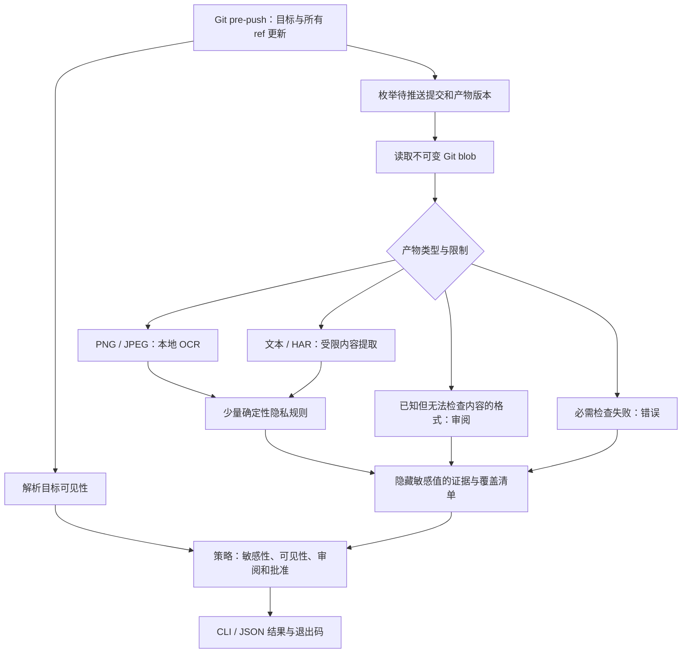

# AgentSafe — 架构草案

[English 原文](ARCHITECTURE.md) · 中文译本。

**状态：** 2026 年 10 月 5 日的拟议设计。只有用户明确批准文档集之后才实现。  
**范围依据：** 产品定义。下面的名称、限制和依赖选择均为提案，不是已经运行的接口。

**二次评审：** [产品复审](PRODUCT.zh-CN.md#second-pass-review)正在质疑默认要求所有图片审阅、首版范围过大，以及把 Git push 当成正确拦截位置的假设。应把这份架构视为等待决定的原始 Git 检查方案；不能把其中详细机制当成已接受的需求来实现。

## 1. 设计决定

使用一个 Python CLI 进程、已安装的 Git 可执行程序，以及本地 OCR。模块放在一个包中。不搭建服务、agent 代理、插件框架或通用 DLP 引擎。

难点是选择正确的已提交版本、解释不完整覆盖，以及把审阅决定绑定到确切内容。检测器数量不是主要架构目标。



## 2. 推荐技术栈

| 关注点 | 建议 | 原因/取舍 |
| --- | --- | --- |
| 运行时 | Python 3.11+；实现时确定受支持小版本 | 迭代快，图片处理生态丰富；不是自包含可执行程序 |
| CLI | [Typer](https://github.com/fastapi/typer) | 小型、带类型的命令层 |
| 终端输出 | [Rich](https://github.com/Textualize/rich)，加纯文本模式 | 证据和进度易读；JSON 必须绕过终端格式化 |
| Git | 用参数数组调用 `git` 子进程 | 检查实际 object/ref 语义；不需要 GitPython |
| 图片解码 | Pillow，初期只分发处理 PNG/JPEG | 限制解码像素，避免声称支持未实现格式 |
| OCR | Tesseract 5 和英文语言数据，通过 [pytesseract](https://github.com/madmaze/pytesseract) 调用 | 本地运行；需安装独立可执行程序与语言数据 |
| OCR 证据 | TSV 单词框和置信度 | 支持按位置检查；[Tesseract TSV 格式](https://tesseract-ocr.github.io/tessdoc/Command-Line-Usage.html) |
| 文本/HAR | Python UTF-8、`json`、小型正则/URL 解析器 | 少量确定性规则，不依赖 NLP 模型 |
| 可见性 | 标准库 HTTP 只读查询 GitHub.com 元数据；可选已认证 `gh api` | 不需要 AgentSafe 账户或存储 token；API 可用时，公开仓库无需认证 |
| 配置 | `.agentsafe.toml`，用 `tomllib` 解析 | 一个明确格式，不做配置框架 |
| 检测结果 | dataclass 和带版本的 JSON 序列化 | 终端/JSON 共享语义，不增加验证框架 |
| 本地状态 | Git 目录下原子写入的 JSON 清单、批准和有限缓存 | 无数据库/守护进程；报告不保存原始产物 |
| 打包 | 标准 `pyproject.toml`；名称确认后采用 pipx 或 uv tool 安装 | 只发布到经过核实、由项目拥有的分发名称下 |
| 验证 | pytest 验证 Git 场景/检测器/CLI；Ruff 和选定的类型检查器 | 测试发布行为与覆盖情况，而不是照抄函数实现 |

Tesseract 的安装成本是真实存在的。拟议首发稳定支持 macOS/Linux；搭配 Git for Windows 的 Windows 支持先标为实验性，直到在干净机器上测试安装、hook 调用、可执行路径与 Unicode 文件名。采用 Python 本身不能证明 OCR 跨平台支持。[OCR 安装说明](https://tesseract-ocr.github.io/tessdoc/Installation.html)。

**替代方案：** Go 让 CLI 分发更容易，但仍需要 OCR 引擎或原生绑定；Rust 提供较强底层控制，但对该 MVP 的集成成本更高。嵌入 ONNX OCR 后端以后可能简化安装，却增加模型打包、运行时、质量和许可证工作。只有安装实验表明 Tesseract 的取舍不合适时，才选择这条路。最初几条规则不需要 Presidio/NER。

## 3. 拟议仓库结构

原始 review 阶段只有根目录五份 Markdown 草案；本次额外增加对应中文版。下列是未来结构，不是现在创建代码的指令。结构中的正式文件名保留英文原名。

```text
agentsafe/
├── README.md
├── PRODUCT.md
├── ROADMAP.md
├── ARCHITECTURE.md
├── AGENTS.md
├── LICENSE                         # 许可证确认之后
├── SECURITY.md                     # 公开发布前建立披露流程
├── pyproject.toml
├── src/agentsafe/
│   ├── __init__.py
│   ├── cli.py                      # 命令解析与流程组织
│   ├── models.py                   # 产物、证据、覆盖情况、结果
│   ├── config.py
│   ├── git_scope.py                # 更新、提交、路径和 blob
│   ├── visibility.py               # 目标身份与元数据
│   ├── artifacts.py                # 选择、类型分发与限制
│   ├── extractors/
│   │   ├── image.py                # OCR 与坐标映射
│   │   ├── text.py
│   │   └── har.py                  # 仅 HTTP header/cookie
│   ├── rules.py                    # 小型隐私规则集
│   ├── policy.py
│   ├── approvals.py
│   ├── state.py                    # 隐藏敏感值的清单与缓存
│   ├── hooks.py                    # 安装/移除自身 pre-push hook
│   └── render.py                   # 纯文本、Rich 和 JSON 展示
├── tests/
│   ├── fixtures/                   # 虚构产物与预期证据
│   ├── test_git_scope.py
│   ├── test_privacy_rules.py
│   ├── test_extractors.py
│   ├── test_policy_approvals.py
│   ├── test_hooks_cli.py
│   └── test_privacy_outputs.py
├── docs/
│   ├── cli.md
│   ├── limitations.md
│   └── demo.md
└── .github/workflows/checks.yml     # 测试本项目，不是用户扫描产品
```

模块保持内聚；如果合并过小模块能提升清晰度，则应合并。不按检测器拆包，不做 monorepo、Web 应用、后台监控或插件注册系统。

## 4. Git 范围是正确性边界

pre-push hook 接收实际 remote 名称/位置，以及 stdin 中的本地和远程 ref/object ID 记录。非零退出会终止推送。应使用这些记录，而不是猜测 `origin/main`。[Git hook 约定](https://git-scm.com/docs/githooks)。

拟议枚举算法：

1. 读取并保留每条 hook stdin 记录；根据仓库 object 格式验证 ID，不能假定 SHA-1 的长度。
2. 忽略仅删除 ref 的更新，因为它不增加本地产物内容。对其他更新，解析指向 commit 的 annotated tag；不支持的非 commit 目标必须明确报为范围不完整。v0.1 不扫描 ref/tag 名称、tag message 和 commit message 内容。
3. 对远程 object 在本地存在的既有目标，枚举从本地目标可达、但从远程声明的目标不可达的 commit。该方法必须适用于正常和强制推送，不能只处理祖先范围。
4. 对新 ref，即远程 object 为零的情况，保守枚举该目标可达的全部历史。不能减去全部本地 remote-tracking ref：另一个目标的私有历史，可能尚未在本目标公开。此方法可能有意重复检查已发布内容。
5. 如果远程声明的 object 在本地缺失，或 shallow/partial 历史阻止完整遍历，返回 ERROR，并提示 fetch/unshallow。不能悄悄退回 HEAD。hook 不执行 fetch，也不修改 ref。检查时关闭 Git 对 promisor object 的自动获取；必需 commit/tree/blob 缺失时报告 ERROR，不隐式联网。
6. 对每个待推送 commit，枚举相对其父提交变化的产物条目；对 merge 检查与所有父提交的比较，root commit 包含所有条目。扫描新增、修改、类型变化及复制/重命名路径。先加入后删除的敏感版本，应在引入它的提交中被发现。集成测试必须与一个明确构建的小型历史预期结果进行比较，验证枚举正确性。
7. 用 Git 底层命令按 object ID 读取每个普通文件版本。按 blob ID 去重提取，但保留每个路径/提交/目标上下文，用于策略和报告。内容缓存命中不等于其他路径已批准。
8. 识别 symlink 和 submodule 条目，不跟随它们。不获取嵌套仓库，也不遍历 symlink 指向的路径。已识别却无法检查内容的产物条目，报告为未检查内容的审阅项；其他条目报告为范围外。

这是对选定待推送历史进行的产物版本审计，不是精确重建 Git 网络 pack。远程声明状态不完整时，可以保守重扫，但不能遗漏。最终 tree 中的删除，不会抵消较早待推送 blob 上的检测结果。

**新 ref 设计更正：** 第 4 步是安全回退，不是可无条件采用的正常快速路径。新分支不等于第一次向仓库推送。如果实际目标的当前 ref 能确定本地已有、且已经发布的提交图，则可以用这些图限定遍历范围；过期 tracking ref 或另一 remote 的 ref 不能。确定算法之前，验证这些信息的获取、竞态和回退语义。Git 可达性/object 遍历见 [git-rev-list](https://git-scm.com/docs/git-rev-list)。普通新功能分支不应仅因目标 ref 是新建，就意外触发暂定的 2,000 次提交上限。

`scan --staged` 读取 index blob，是提前预览。`scan --remote ... --ref ...` 用只读远程 ref 解析一个目标更新；有歧义时要求 `--to-ref`，并标为预演。两者都不能替代实际推送时 hook 的完整输入。

## 5. 目标与可见性

- 规范化目标身份由服务商 host 加规范化仓库路径组成；GitHub.com 为 owner/name，依据 hook 提供的位置确定。包含凭证的 URL 不得以原始形式打印或存储。
- 支持可识别的 GitHub.com HTTPS 和 SSH URL。检查实际生效的 push URL 身份，不能拿 fetch URL 替代，也不能假定是 `origin`。直接向 URL 推送是有效输入。
- 查询返回 `{state, source, observed_at, destination}`。成功的权威响应为 PUBLIC、PRIVATE 或 INTERNAL；查询、认证、网络、限流或解析失败为 UNKNOWN，不能变成 PRIVATE。
- 对可识别的 GitHub.com 公开目标，优先匿名查询元数据。仅在配置需要时通过 CLI 复用 `gh` 认证；不得将凭证复制到 AgentSafe 状态中。
- UNKNOWN 使用公开检查规则。离线 `assume-public` 始终标为假设，不是已经验证的元数据结果。不能用过期私有结果降低检查强度。
- 未使用 assume-public 模式时，每次真实 push 都重新查询可见性，不永久缓存“私有”。查询之后仍可能发生可见性变更，这是竞态/托管平台边界，不是工具能消除的问题。
- v0.1 中，企业 host 和其他服务商的可见性为 UNKNOWN；可识别的 host/仓库路径仍可为批准建立独立目标身份。不得用 GitHub 凭证查询任意 host。
- 如果 SSH 别名或重写 URL 导致无法可靠确定目标身份，这是独立的解析失败，而不只是可见性未知。只读预览可采用保守公开策略，但真实检查返回 ERROR，直到用户使用可识别的目标。不能对共享 UNKNOWN 身份保存或复用批准。`doctor` 应解释区别。
- 多个 push 目标必须在各自调用中分别检查。不保证跨目标原子性；较早的目标可能已经接受推送，较晚的调用才被阻止。

内容提取和规则检查在本地运行。可见性请求会向 GitHub 暴露目标元数据与 API 请求信息，但不上传 blob、路径、OCR 文本或检测结果。不自动下载模型、检查更新或发送遥测。安装过程可以下载依赖；运行期扫描必须能够在保守公开策略下离线运行。

## 6. 提取、限制与检测

同时使用文件签名与扩展名/路径线索。明确产物目录只影响选择范围。受支持图片进入有限制的解码器和 OCR；大小受限的 UTF-8 文本进入文本规则；HAR 解析文档规定位置的 header/cookie 数组。不能声称检查了 HAR 请求/响应 body、编码附件或任意压缩载荷。保留原始字节到行/字段的映射。

拟议初始限制，需通过基准测试验证：

| 资源 | 初始限制 | 达到/超过限制时的行为 |
| --- | --- | --- |
| 受支持图片字节数 | 每个版本 10 MiB | 必需检查超过限制时 ERROR |
| 图片解码面积 | 2,000 万像素（20 megapixels） | ERROR，不能悄悄缩小图片而丢掉敏感文字 |
| 受支持文本/HAR 字节数 | 每个版本 5 MiB | ERROR，不能只扫开头就宣称完整 |
| OCR 执行时间 | 每张图片 10 秒 | ERROR，并明确显示覆盖失败 |
| 待推送范围 | 200 个不同产物版本、2,000 次提交 | ERROR，文档说明对首次推送的影响 |
| 整次检查 | 60 秒 | ERROR，说明已检查与未检查内容 |

这些限制是暂定值，不是已经测量出的最优值。用户可有意修改限制；报告记录实际生效限制和策略指纹。原本不做内容检查的视频/PDF 是 REVIEW，但受支持 PNG 扫描超时是 ERROR。`allow` 不能把后者变成成功扫描。

规则边界：

- 邮箱检测识别可能的身份标识，不判断员工/客户身份是否保密。排除保留示例地址和明显占位符；公开联系邮箱仍可能需要审阅。
- 内部域名敏感性依据明确配置。解析 host，匹配确切域名/子域名边界；公开 URL 中出现一个子字符串不足以命中。localhost/测试地址本身不能判 HIGH。
- auth/cookie 规则要求已知 header/cookie 位置中存在非空值。文档只提到 `Authorization` 而没有值，不属于检测结果。cookie 存在不证明是认证会话：已配置敏感会话 cookie 名称为 HIGH；其他非空 cookie 为 MEDIUM/审阅。不在线验证，也不请求检测到的 endpoint。
- OCR 置信度是提取元数据，不是安全概率。低置信度规则证据需要审阅，不应强烈宣称存在泄漏。坐标与原始图片保持绑定。
- 初稿中，每张选定图片都具有独立于 OCR 结果的审阅要求。空 OCR 输出不能证明内部图表或不可读名称无害。已知但无法检查内容的产物，具有确认覆盖限制的审阅要求。
- 产物路径内的一般 JSON/CSV/报告文本，只使用文本规则。必须明确输出这种覆盖情况。仅有大小线索属于建议性提醒，不是泄漏检测结果。

本版本不加入 QR 解码。如果以后评估，[ZXing-C++](https://github.com/zxing-cpp/zxing-cpp)提供 Python 绑定；解码字符串必须作为本地不可信内容处理，不能访问或执行。

## 7. 数据模型与策略

保持三个独立维度：

- **证据：** 规则 ID、类别、严重性、提取质量、坐标/行/JSON 字段；原始值只在处理过程中暂时存在。
- **覆盖情况：** 已检查、未检查/无法检查内部内容、忽略、范围外或失败；引擎版本、限制和原因。
- **决策：** allow、warn、review、block 或 error；目标可见性与适用批准。

产物记录包含 Git blob ID/object 格式、路径、引入它的提交上下文、规范化目标及选择原因。带版本的扫描清单包含产物记录、隐藏敏感值的证据、覆盖汇总、策略指纹和结果。稳定的本地项目 ID 在推送阻止之后，解析到一个不可变产物项；它汇总同一 blob/路径/目标的检测结果和审阅要求。HIGH 图片项包含其图片审阅；另一个产物版本/路径仍是单独项目。不要通过哈希原始低熵 PII 生成标识符；应使用 object/规则/位置上下文。

策略遵循产品定义。在 PUBLIC/UNKNOWN 下，未解决的 HIGH 或 REVIEW 项阻止推送；已验证 PRIVATE/INTERNAL 采用建议性质。任何必需检查失败都会产生 `error`/退出码 2。有批准/忽略的报告必须说明这些情况，不能只显示“所有产物安全”。

## 8. 批准与本地状态生命周期

通过 Git 路径 API 解析状态位置，包括 worktree；不能假定 `.git` 是目录。隐藏敏感值后的清单、批准与缓存放在 Git 目录下，与被跟踪的配置分开。在系统支持时采用原子写入与受限权限；操作系统管理员和恶意本地行为不属于此信任模型。

批准记录确切 blob ID、产物路径、仓库身份、规范化目标、已明确审阅的全部结果 ID/规则版本或审阅要求、策略指纹、理由和时间。写入前，命令必须完整显示批准范围。对一个 blob 的批准不意味着以后该文件名都进入 allowlist。规则/策略变化后，保守地使受影响批准失效。

默认批准持续到内容/上下文/策略变化，或用户明确撤销；不宣称认证过人工身份或拥有人工签名。`--yes` 是明确自动化授权，不是人工审阅证明。理由应说明虚构/公开上下文，不包含敏感值。

缓存只保存隐藏敏感值后的提取结果/证据和覆盖情况；缓存键为 `{blob, extractor/rule versions, language data fingerprint, config/limit fingerprint}`。复用缓存时仍要评估当前路径/目标/批准。不得缓存原始 OCR 文本或解码器原始 stderr。缓存可选；不做守护进程、SQLite 服务或事件总线。

保留最近 10 个隐藏敏感值后的清单，让 ID 仍可检查，淘汰最旧清单。批准记录独立保留，直到撤销。`--open` 检查可将原始 Git blob 生成为本地受限预览文件，不能放入工作区。明确说明这是“存储隐藏敏感值”原则的例外；下次调用时移除旧预览，包括超过 24 小时的预览。没有清理守护进程：工具不再运行时，预览可能持续存在；清理也不是安全擦除。检查期间不嵌入远程图片 URL，也不加载网络资源。

## 9. Hook 生命周期与输出安全

`init` 验证工具/配置；只有实际生效的 hook 位置为空，或已经属于自身时，才写入受管理 hook。检查 `core.hooksPath` 和 worktree 布局。目录已存在是正常情况，但共享/全局 hook 位置即使为空也拒绝安装，改为提供手工集成说明。拒绝覆盖或自动串联无关 hook。提供先缓冲、再向每个 hook 重放 stdin 的手工组合示例；不能让两个命令依次消耗同一个已经读完的流。安装只针对仓库本地，不做全局改动。

受管理 hook 调用已知的 CLI 环境，正确引用并传递参数，把完整 stdin 和目标参数交给检查工具。依赖/环境失败必须停止推送，并提供有用说明。`uninstall` 只移除未被改动、归 AgentSafe 管理的 hook；保留用户修改及其他 hook。

Git 路径/object ID 不通过 shell 插值。过滤文件名/内容中的终端控制字符；对不可信字符串关闭 Rich markup 解释；JSON 正常转义。不转发工具原始 stderr、带凭证的 remote、匹配值或源文本行。结构化输出放在 stdout，进度/诊断放在 stderr。hook 模式不交互。

## 10. 现有 secret 引擎

建议在 AgentSafe 之外保留现有的源码 secret 检查。为了缩小首版，强制引擎适配器后置。

如果以后用户需要适配器，应从 [Gitleaks](https://github.com/gitleaks/gitleaks) 文档中的文件/stdin 接口开始，把根据确切 blob 得到的文本，包括 OCR 输出，在本地传给引擎，固定已测试版本，并将隐藏敏感值后的结果标准化。不要 fork 其规则目录。当前 README 将新增功能开发引导至 Betterleaks，因此在确定长期集成之前重新评估后端维护情况。检查子进程报告和 stderr 是否泄漏原始值；仅有 redaction flag 不足以保证输出安全。

通过远程 API 验证凭证不在范围内。它会改变数据流边界，且不是建立产物发布体验所必需的。

## 11. 批准后必须进行的验证

仅使用虚构样本。必要行为测试覆盖：首次/新 ref 推送、多个 ref、直接 remote URL、不同 push remote、强制推送可达性、merge 历史、先加入后删除、先加入后打码、重命名/复制、staged 与已提交内容不同、tag 处理、远程 object 缺失、shallow 历史、SHA object 格式差异、特殊文件名、symlink/submodule/LFS 边界、hook 冲突，以及卸载时确认归属。

检测测试覆盖：无害 header 提及、占位值、公开/示例邮箱、域名边界伪装、HAR 非空字段、不可读图片、损坏输入、解压限制和超时。批准测试证明内容字节/路径/目标/策略变化后失效。输出测试确认普通、JSON、错误和子进程诊断中均不出现原始凭证/PII。观察网络的测试应证明 blob/OCR/报告内容没有被上传。

发布前公布支持覆盖范围，以及实际安装/延迟测量。不能依据这份草案宣称已经准备好 release。
