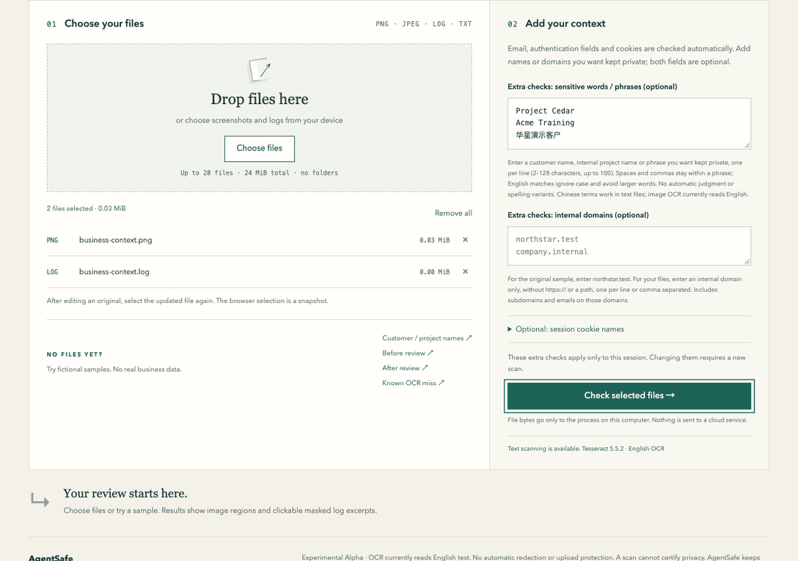

<p></p>

# AgentSafe

[中文](README.zh-CN.md) · [User guide](docs/USAGE.md) · [Contributing](CONTRIBUTING.md) · [Security](SECURITY.md)

**Share the bug. Keep the private context.**

Your AI agent captured a screenshot for a bug report. Did your internal project name come along?

AgentSafe checks screenshots and debugging logs on your computer before you share them. Tell it which names, phrases or domains to look for, review the detected locations, then **manually cover image regions and save a new PNG**. Use a local browser interface; a CLI is available too. File contents are not sent to external services during checks.

**Experimental Alpha · You start each check · No automatic upload or Git protection · Zero findings do not mean safe.**



Real Alpha interface, fictional data. Continuous recording with pointer/click highlights; covering uses manual selection and dragging. The final check covers only the new image, not the log. [Still screenshots and walkthrough](docs/USAGE.md#first-check-no-private-files-needed).

## Try it

Start on macOS with [Homebrew](https://brew.sh/). This installs the released source Alpha from GitHub, not PyPI. Installation needs internet access; image checks require local Tesseract with English data.

```sh
brew install python@3.12 tesseract pipx git
pipx install --backend pip --python python3.12 'git+https://github.com/Minjia-Hu/agentsafe.git@v0.1.0a1'
pipx ensurepath
```

Open a **new terminal window**, then run:

```sh
agentsafe doctor
agentsafe gui
```

Wait for `doctor` to report `READY` before checking images. Keep the terminal running while you use the browser; use `agentsafe gui` to open it again later. Add `--lang zh` for Chinese. No standalone installer is available yet; Windows is not validated. [Source checkout, Linux and troubleshooting](docs/USAGE.md#installation-options). [Tested environments and setup gaps](docs/VALIDATION.md#readme-workflow-and-pipx--october-25-2026).

1. Click **Customer / project names** to try a fictional screenshot and log—no private files needed.
2. Click a finding to review its image location or masked log line.
3. Choose **Cover image manually**, select regions, then **Create & check PNG copy**.
4. Review the whole copy and **Save PNG copy**. The original stays unchanged. Edit logs in your usual editor, reselect them, and check again.

## What it checks today

| Input | Review assistance |
| --- | --- |
| PNG / JPEG screenshots | English OCR; locations for detected text; manual opaque covering into a new PNG |
| UTF-8 `.log` / `.txt` | Findings with line numbers and bounded, masked context; Chinese configured phrases work here |
| Your configured phrases, domains and session-cookie names | Literal matching; names are not automatically classified as confidential |
| Recognized authentication fields, emails and cookies | Structural findings or review warnings; credentials are not verified |

Small or blurred text can be missed. No readable image text requires manual review. Arbitrary API keys/passwords, QR codes, PDFs, video, HAR parsing and hidden metadata are outside coverage. Unsupported inputs and failed checks are reported. [Full detection rules and limits](docs/USAGE.md#what-it-checks).

## Learn more

- [GUI walkthrough, CLI and configuration](docs/USAGE.md) · [Local processing and retained data](docs/USAGE.md#local-processing-and-retained-data)
- [Validation](docs/VALIDATION.md) · [Product reasoning](PRODUCT.md) · [Roadmap](ROADMAP.md) · [Architecture](ARCHITECTURE.md)
- [Report a bug with fictional samples](https://github.com/Minjia-Hu/agentsafe/issues/new/choose) · [Report a vulnerability privately](SECURITY.md)

Feedback we need: could you install it, finish a first review, and find a reason to use it again? Synthetic demos demonstrate behavior, not real-world accuracy or proven demand.

AgentSafe code, original icons and fictional fixtures use the [MIT license](LICENSE). Dependencies retain their own licenses; see [third-party notes](THIRD_PARTY_NOTICES.md). Python and Tesseract are not bundled.
