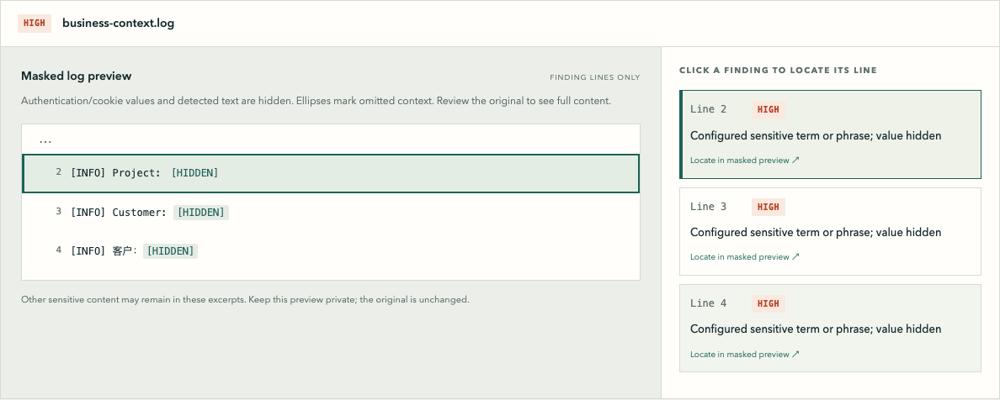

<p></p>

# AgentSafe

[中文](README.zh-CN.md) · [Contributing](CONTRIBUTING.md) · [Security](SECURITY.md) · [MIT license](LICENSE)

**Check screenshots and debugging logs locally before you share them.**

> Don't accidentally publish what your AI agent saw or generated.

AgentSafe finds supported privacy signals in screenshots and logs, shows where to review them, and lets you manually cover image regions into a new PNG. Use the local browser interface or the CLI; both share the same scanner. Files stay on your computer during inspection.

**Experimental Alpha — source installation.** Expect limited detection coverage and changes to the interface. This is a manual review tool: it does not intercept Git pushes or uploads, and zero findings do not certify privacy. No standalone installer or PyPI installation is offered in this Alpha.


Actual Alpha interface with the bundled fictional Customer / project names sample. The view above shows the screenshot findings; the two-file sample also includes a log.

## Try it from source

Start with macOS and Python 3.12. Python 3.11+ is required by the package; image checks also require Tesseract with English (`eng`) data. See [validation](docs/VALIDATION.md) for exactly what has been exercised. CI passed on Ubuntu 24.04 / Python 3.11 and 3.12, and macOS 14 / Python 3.12. Windows is not yet validated.

On macOS, install [Homebrew](https://brew.sh/) first if you do not already have it. Then open Terminal:

```sh
brew install python@3.12 tesseract git
git clone https://github.com/Minjia-Hu/agentsafe.git
cd agentsafe
python3.12 -m venv .venv
.venv/bin/python -m pip install .
.venv/bin/agentsafe doctor
.venv/bin/agentsafe gui
```

Installation downloads dependencies. Subsequent artifact checks run locally. Do not substitute `pip install agentsafe`: that package name is not this project's distribution channel.

`doctor` should report `READY` for English OCR. If it reports an error, fix it before trying screenshots. UTF-8 log/text scanning can work without OCR. `gui` opens your default browser; keep the terminal process running. Later, from the `agentsafe` directory, run just `.venv/bin/agentsafe gui`. Add `--lang zh` for a Chinese interface.

Ubuntu/Debian starting point (Linux validation status is in the record above): install `git python3 python3-venv tesseract-ocr tesseract-ocr-eng` with your package manager, then use the same clone/install steps with `python3` in place of `python3.12`. Verify `python3 --version` is at least 3.11.

### First check: no private files needed

1. Click **Customer / project names**. This bundled fictional example supplies its own sensitivity settings.
2. Click an image finding to locate it. Click a log finding to highlight its masked line.
3. Choose **Cover image manually** below the image. Select detected regions, draw rectangles, or enter pixel coordinates; undo/reset if needed.
4. Choose **Create & check PNG copy**. Review the new image's results, then **Save PNG copy**.

The saved `*-redacted.png` contains opaque replacement pixels; the original is unchanged. Rechecking uses the original scan's sensitivity settings and covers only the new image. Other previously selected files are not rechecked in that result. Review the whole copy before sharing: unselected content may still be sensitive.


For your files, select PNG/JPEG screenshots or UTF-8 `.log`/`.txt` files. Optional **Sensitive words / phrases** can contain customer/project names, one per line; **Internal domains** accepts domains such as `northstar.test`, not full URLs. Configured session-cookie names are also supported. Empty context fields still allow general email/authentication/cookie checks; organization-specific sensitivity is not inferred. Settings last only for this session.

Modify logs with your usual editor, select the updated files again, and recheck. Log excerpts hide recognized authentication/cookie values and detected terms/domains/emails. Ambiguous authentication context is withheld. Other private context can remain; excerpts are a review aid, not a sanitized export. End the session with **End session** or Ctrl+C in the terminal.



Log review preserves line numbers and hides detected values. These excerpts are a review aid, not a sanitized file for sharing.

## What it checks

| Input or signal | Current behavior |
| --- | --- |
| PNG/JPEG | Local English OCR with source-pixel locations; small or blurred text can be missed |
| UTF-8 `.log` / `.txt` | Direct text scanning and original line numbers; Chinese configured phrases work here |
| Configured names/phrases and domains | Literal matching; reliable matches are HIGH, uncertain OCR matches WARN |
| Populated Authorization / Proxy-Authorization fields; configured session cookies | Structural HIGH findings; validity is not checked |
| Other emails or populated cookies | WARN; examples/placeholders are handled separately |
| No readable image text | Explicit manual-review limitation; never a safe-image verdict |
| Unsupported, corrupt, oversized or failed input | Visible incomplete coverage/error |

Authentication/cookie rules recognize line-local `Name: value`, `Name=value`, and single/double-quoted scalar fields such as `"Authorization":"value"`. Escaped closing quotes are handled without changing source offsets. This is not full JSON/HAR parsing: nested values, encoded keys and multiline values are outside detection coverage. When a retained line contains a recognizable auth/cookie label with an ambiguous value boundary, its excerpt is withheld and only the finding location is shown.

Detection does not cover arbitrary API keys/passwords, automatic confidential-name/dashboard recognition, faces, QR codes, PDF, video, HAR parsing or hidden metadata. There is no automatic redaction, directory crawling, agent interception or Git integration. Supported inputs are checked regardless of whether a person or an AI created them.

Limits include 20 files / 24 MiB per GUI selection, 10 MiB / 20 megapixels per image, 5 MiB per text file and a 10-second OCR timeout. Animated and EXIF-rotated images are rejected. CLI input paths containing symlinks are rejected; install into a real directory path as well so the bundled CLI demo can read its packaged files. Transparent images are rendered on white. Full resource limits are in [ARCHITECTURE.md](ARCHITECTURE.md#4-extraction-and-resource-limits).

## CLI

From the checkout, try the supplied fictional originals:

```sh
.venv/bin/agentsafe scan examples/synthetic/dashboard.png examples/synthetic/session.log --config examples/synthetic/policy.toml
```

This deliberately returns **1** because the files contain supported risk signals. Compare the separately prepared reviewed files:

```sh
.venv/bin/agentsafe scan examples/synthetic/dashboard-reviewed.png examples/synthetic/session-reviewed.log --config examples/synthetic/policy.toml
```

This is expected to return **0**, with a warning for a preference cookie. OCR results can vary by version; [fixture labels](examples/synthetic/README.md) describe the examples.

| `scan` exit | Meaning |
| --- | --- |
| 0 | All requested inputs inspected, no HIGH findings; warnings or OCR limitations may remain |
| 1 | HIGH findings need review |
| 2 | Input, configuration or inspection failure; takes precedence over findings |

A small optional TOML file supplies context:

```toml
sensitive_domains = ["northstar.test"]
sensitive_terms = ["Project Cedar", "Acme Training"]
session_cookie_names = ["demo_session"]
```

Use `--config path/to/policy.toml` explicitly; no implicit repository policy is loaded. Matching is literal, case-insensitive within one line, with flexible spacing and English word boundaries; no regular expressions or fuzzy classification. Policy fields accept up to 100 entries each; phrases are 2–128 characters. Explanations hide matched values.

`.venv/bin/agentsafe demo` runs packaged synthetic cases and opens a static local review page, including a known OCR miss. `.venv/bin/agentsafe scan ... --preview` creates a static review of selected inputs. Add `--no-open` to suppress browser launch. Static previews contain visible images/masked log excerpts, are private, and have no editor. `demo` returns 0 when the demonstration completes, even when example scans find HIGH signals; 2 means incomplete inspection.

## Local processing and retained data

- Ordinary CLI scans make no network requests. The GUI communicates only with an authenticated process on `127.0.0.1`; it has no remote upload, telemetry, CDN or cloud model. Installation downloads are separate.
- GUI inputs, policy, masked excerpts, visible image snapshots and generated copies are held in memory. They are released on replacement, clear/end, process exit or 30 minutes without authenticated API requests. Closing the tab alone does not immediately stop the process. Only the connection token uses tab session storage.
- An explicit **Save PNG copy** downloads a file you manage yourself. Browser/OS caching is outside the memory-only process promise. Modified originals must be selected again.
- Static `demo` / `--preview` pages are written to private OS-temp directories outside the repository. Eligible unchanged sessions older than 24 hours are cleaned on a later preview creation; there is no background deletion. Delete these pages manually when finished. They contain visible image pixels and potentially private context.

See [SECURITY.md](SECURITY.md) before reporting a vulnerability or attaching diagnostic material.

## Development and project status

Install development dependencies and run the behavior tests:

```sh
.venv/bin/python -m pip install '.[dev]'
.venv/bin/python -m pytest -q
```

Tests use fictional data. Real OCR tests skip if Tesseract/`eng` is missing; a skipped run is not OCR validation. CI installs OCR and rejects skipped tests. After editing source, reinstall with `.venv/bin/python -m pip install .` to refresh the installed CLI/GUI. See [CONTRIBUTING.md](CONTRIBUTING.md) for the installed-wheel smoke check and contribution scope.

The optional `AgentSafe.app` development launcher must be built with `.venv/bin/python scripts/build_macos_launcher.py` on a prepared Mac with Apple Command Line Tools. Its executable is not committed; it depends on that machine's existing Python, OCR and a private temporary runtime snapshot. It is not a downloadable independent app.

Current focus: a reproducible Alpha, useful review feedback, and installation improvements. Independent installers, additional languages/formats and publishing integrations need their own validation. Synthetic examples demonstrate behavior, not real-world accuracy or market demand.

- [Validation and remaining gaps](docs/VALIDATION.md)
- [Product reasoning](PRODUCT.md) · [Roadmap](ROADMAP.md) · [Architecture](ARCHITECTURE.md)
- [Contribute](CONTRIBUTING.md) · [Report a bug](https://github.com/Minjia-Hu/agentsafe/issues/new/choose)

## License

AgentSafe source, original geometric icons and fictional fixtures are under the [MIT license](LICENSE). Dependencies keep their own licenses; see [third-party notes](THIRD_PARTY_NOTICES.md). No Tesseract or Python runtime is bundled in this source Alpha.
