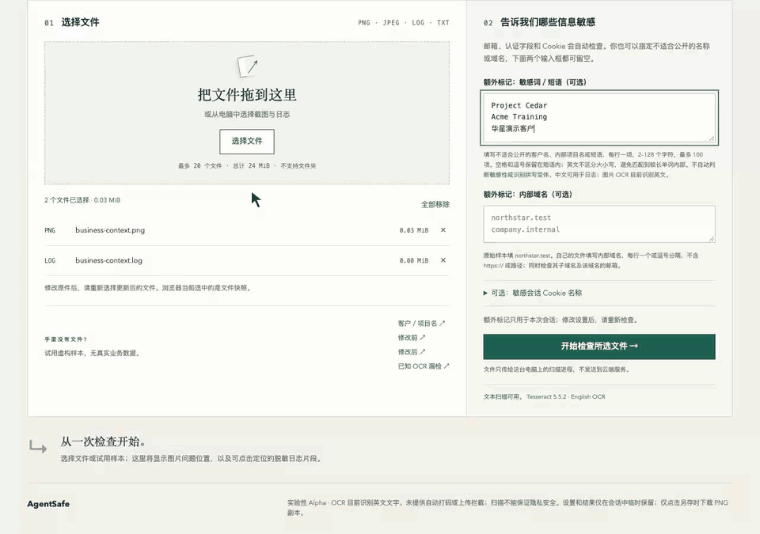

<p></p>

# AgentSafe

[English](README.md) · [使用指南](docs/USAGE.zh-CN.md) · [参与贡献](CONTRIBUTING.zh-CN.md) · [安全反馈](SECURITY.zh-CN.md)

**分享问题，别顺手分享了私密信息。**

AI Agent 为问题报告截了一张图，内部项目名是不是也跟着进去了？

AgentSafe 在分享前，在你的电脑上检查截图与调试日志。告诉它要查找的名称、短语或域名，查看检测到的位置，再**手动遮盖图片区域，另存为新的 PNG**。主要通过本地浏览器界面操作，也提供 CLI。检查期间不向外部服务发送文件内容。

**实验性 Alpha · 检查由你发起 · 不自动拦截上传或 Git 推送 · 零发现不代表安全。**



真实 Alpha 界面，全部为虚构数据。连续操作录屏，添加鼠标与点击提示；遮盖通过手动勾选和拖动完成。最后一次检查仅针对新图片，不包括日志。[静态截图与操作说明](docs/USAGE.zh-CN.md#第一次检查无需准备私密材料)。

## 开始体验

建议先在已安装 [Homebrew](https://brew.sh/) 的 macOS 上体验。以下从 GitHub 安装已发布的源码 Alpha，不通过 PyPI。安装需要联网，图片检查需要本地 Tesseract 和英语数据。

```sh
brew install python@3.12 tesseract pipx git
pipx install --backend pip --python python3.12 'git+https://github.com/Minjia-Hu/agentsafe.git@v0.1.0a1'
pipx ensurepath
```

打开一个**新的终端窗口**，执行：

```sh
agentsafe doctor
agentsafe gui --lang zh
```

`doctor` 显示 `READY` 后再检查图片。使用浏览器时保持终端运行；以后执行 `agentsafe gui --lang zh` 即可重新打开，不加语言参数默认英文。目前没有独立安装包，Windows 尚未验证。[源码安装、Linux 与排错](docs/USAGE.zh-CN.md#安装方式)。[实测环境与安装缺口](docs/VALIDATION.zh-CN.md#readme-演示与-pipx2026-年-10-月-25-日)。

1. 点击「客户／项目名」，体验内置虚构截图与日志，无需准备私密文件。
2. 点击检测条目，查看图片位置或脱敏日志行。
3. 点击「手动打码」，选择区域，再点击「生成并检查 PNG 副本」。
4. 查看整个副本，然后「另存 PNG 副本」，原件不变。日志请用常用编辑器修改，重新选择后再检查。

## 现在能检查什么

| 输入 | 提供的辅助 |
| --- | --- |
| PNG / JPEG 截图 | 英语 OCR、检测文字的位置；手动不透明遮盖并生成 PNG 副本 |
| UTF-8 `.log` / `.txt` | 问题行号与有限脱敏上下文；支持配置中文短语 |
| 你配置的短语、域名和会话 Cookie 名称 | 字面匹配；不会自动判断哪些名称属于机密 |
| 可识别的认证字段、邮箱与 Cookie | 结构性发现或审阅提醒；不验证凭证有效性 |

小字或模糊文字可能漏检，未识别出文字的图片需人工检查。任意 API key/密码、二维码、PDF、视频、HAR 解析和隐藏元数据不在覆盖范围内；不支持的输入和检查失败会明确报告。[完整规则与限制](docs/USAGE.zh-CN.md#当前检查能力)。

## 进一步了解

- [GUI 操作、CLI 与配置](docs/USAGE.zh-CN.md) · [本地处理与数据保留](docs/USAGE.zh-CN.md#本地处理与数据保留)
- [验证记录](docs/VALIDATION.zh-CN.md) · [产品定义](PRODUCT.zh-CN.md) · [路线图](ROADMAP.zh-CN.md) · [架构](ARCHITECTURE.zh-CN.md)
- [用虚构样本反馈问题](https://github.com/Minjia-Hu/agentsafe/issues/new/choose) · [私下报告漏洞](SECURITY.zh-CN.md)

我们希望了解：你能否装好、完成第一次审阅，以及是否有再次使用的理由。虚构演示只展示行为，不证明现实准确率或市场需求。

AgentSafe 代码、原创图标与虚构样本采用 [MIT 许可证](LICENSE)。依赖保留各自许可证，见[第三方说明](THIRD_PARTY_NOTICES.md)。不捆绑 Python 或 Tesseract。
