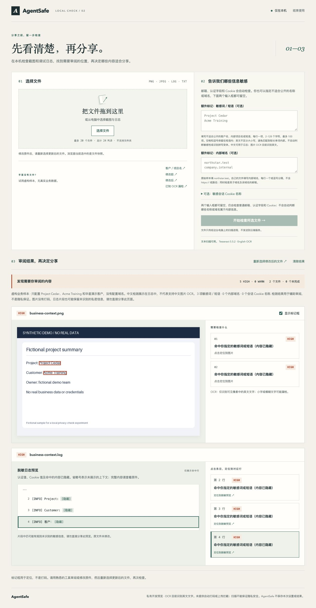
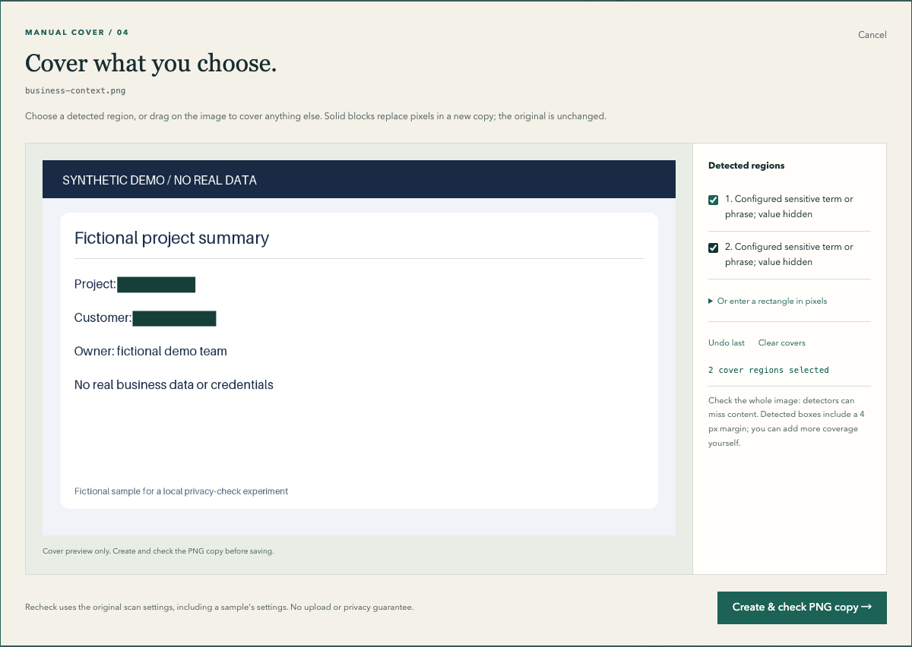

<p></p>

# AgentSafe

[English](README.md) · [参与贡献](CONTRIBUTING.zh-CN.md) · [安全反馈](SECURITY.zh-CN.md) · [MIT 许可证](LICENSE)

**分享之前，在本地检查截图与调试日志。**

> 别把 AI Agent 看到或生成的敏感内容，无意间发布出去。

AgentSafe 检查截图和日志中的受支持隐私信号，定位需要审阅的内容，并让你手动遮盖图片区域、生成新的 PNG。浏览器界面与 CLI 使用同一个扫描核心，检查过程中素材保留在你的电脑上。

**实验性 Alpha，采用源码安装。** 检测范围有限，界面可能变化。这是人工触发的审阅工具，不拦截 Git push 或上传；零发现不代表安全。此 Alpha 尚不提供独立安装包或 PyPI 安装。



## 从源码开始体验

建议先使用 macOS 和 Python 3.12。软件包要求 Python 3.11+，图片检查还需要 Tesseract 与英语（`eng`）数据。[验证记录](docs/VALIDATION.zh-CN.md)列明实际检查过的环境。Ubuntu 24.04 / Python 3.11、3.12 与 macOS 14 / Python 3.12 的 CI 已通过；Windows 尚未验证。

macOS 用户如未安装 [Homebrew](https://brew.sh/)，请先安装，然后打开终端执行：

```sh
brew install python@3.12 tesseract git
git clone https://github.com/Minjia-Hu/agentsafe.git
cd agentsafe
python3.12 -m venv .venv
.venv/bin/python -m pip install .
.venv/bin/agentsafe doctor
.venv/bin/agentsafe gui --lang zh
```

仓库仍为私有时，克隆需要访问权限；这是为公开仓库准备的安装路径。安装会下载依赖，之后的素材检查在本地运行。不要改用 `pip install agentsafe`，该包名不是本项目的分发渠道。

`doctor` 应显示英语 OCR 已就绪（`READY`）；若有错误，先修复再检查图片。UTF-8 日志/文本可以不依赖 OCR。`gui` 会打开默认浏览器，请保持终端进程运行。以后在 `agentsafe` 目录执行 `.venv/bin/agentsafe gui --lang zh` 即可重新打开；不加语言参数默认英文。

Ubuntu/Debian 起步方式：用包管理器安装 `git python3 python3-venv tesseract-ocr tesseract-ocr-eng`，之后执行相同克隆与安装步骤，将 `python3.12` 替换为 `python3`。先确认 `python3 --version` 至少为 3.11；Linux 的实测状态见上方验证记录。

### 第一次检查，无需准备私密材料

1. 点击「客户／项目名」。内置虚构样本会使用自己的敏感性配置。
2. 点击图片检测条目定位内容；点击日志条目高亮对应的脱敏行。
3. 点击图片下方「手动打码」。勾选检测区域、拖动矩形，或填写像素坐标，可撤销或清空。
4. 点击「生成并检查 PNG 副本」，审阅新图片的结果，再点击「另存 PNG 副本」。

保存的 `*-redacted.png` 使用不透明像素覆盖，原件不变。重检沿用原扫描的敏感性设置，仅针对这张新图片，不会同时重检之前选中的其他文件。分享前仍需查看整个副本，未选择区域可能保留敏感内容。



检查自己的材料时，选择 PNG/JPEG 截图或 UTF-8 `.log`/`.txt`。可选的「敏感词／短语」填写客户名、项目名等，每行一项；「内部域名」填 `northstar.test` 这样的域名，而非完整 URL。也可配置会话 Cookie 名称。留空仍会检查普通邮箱、认证字段与 Cookie，但不会推断你公司的敏感性规则。设置仅保留在当前会话中。

日志请用常用编辑器修改，重新选择更新后的文件再检查。日志片段隐藏认证/Cookie 值和检测到的短语/域名/邮箱，但可能保留其他私密上下文；它是审阅辅助，不是脱敏导出文件。完成后点击「结束使用」，或在终端按 Ctrl+C。

## 当前检查能力

| 输入或信号 | 当前行为 |
| --- | --- |
| PNG/JPEG | 本地英语 OCR，提供原图像素位置；小字或模糊文字可能漏检 |
| UTF-8 `.log` / `.txt` | 直接处理文本并提供原始行号，支持配置中文短语 |
| 配置的名称/短语与域名 | 字面匹配；可靠提取为 HIGH，不确定 OCR 为 WARN |
| 带值的 Authorization / Proxy-Authorization、配置的会话 Cookie | 结构性 HIGH，不验证凭证有效性 |
| 其他邮箱或带值的 Cookie | WARN，另行处理示例地址和占位符 |
| 图片未提取出可读文字 | 明确提示人工审阅，不宣称图片安全 |
| 不支持、损坏、超限或检查失败 | 明确显示覆盖不完整或错误 |

目前不支持任意 API key/密码检测、自动识别敏感名称或内部后台、人脸、二维码、PDF、视频、HAR 解析或隐藏元数据。没有自动打码、目录遍历、Agent 拦截或 Git 集成。受支持的输入都会检查，不区分人或 AI 生成。

限制包括 GUI 每次最多 20 个文件/24 MiB，单张图片 10 MiB/2000 万像素，单个文本 5 MiB，单次 OCR 超时 10 秒。CLI 拒绝包含符号链接的输入路径；安装目录也应使用真实路径，以便内置 CLI 演示读取软件包素材。拒绝动画及带 EXIF 旋转标记的图片；透明像素渲染在白底上。完整限制见 [ARCHITECTURE.md](ARCHITECTURE.md#4-extraction-and-resource-limits)。

## CLI

在仓库目录中检查内置虚构原件：

```sh
.venv/bin/agentsafe scan examples/synthetic/dashboard.png examples/synthetic/session.log --config examples/synthetic/policy.toml
```

它预期返回 **1**，因为示例含有受支持的风险信号。再检查预先制作的修改后文件：

```sh
.venv/bin/agentsafe scan examples/synthetic/dashboard-reviewed.png examples/synthetic/session-reviewed.log --config examples/synthetic/policy.toml
```

它预期返回 **0**，并保留一条普通偏好 Cookie 提醒。OCR 结果可能随版本变化；[样本标签](examples/synthetic/README.md)描述了预期行为。

| `scan` 退出码 | 含义 |
| --- | --- |
| 0 | 所有请求输入均已检查，没有 HIGH；仍可能有提醒或 OCR 局限 |
| 1 | 发现 HIGH，需要审阅 |
| 2 | 输入、配置或检查失败，优先于发现数量 |

可使用小型 TOML 文件提供上下文：

```toml
sensitive_domains = ["northstar.test"]
sensitive_terms = ["Project Cedar", "Acme Training"]
session_cookie_names = ["demo_session"]
```

通过 `--config path/to/policy.toml` 明确指定，不自动加载仓库配置。规则在单行内做不区分大小写的字面匹配，允许空白差异并遵守英文单词边界，不支持正则或模糊分类。每个配置字段最多 100 项；短语长度为 2–128 字符。问题说明隐藏命中的值。

`.venv/bin/agentsafe demo` 运行打包的虚构样本，打开静态本地审阅页，包含已知 OCR 漏检案例。`.venv/bin/agentsafe scan ... --preview` 生成指定输入的静态预览，加 `--no-open` 可不自动打开浏览器。静态预览含可见图片和脱敏日志片段，应保持私密，不提供编辑器。`demo` 完成演示即返回 0，即使示例扫描发现 HIGH；检查不完整则返回 2。

## 本地处理与数据保留

- 普通 CLI 扫描不发出网络请求。GUI 仅连接本机 `127.0.0.1` 上有认证的进程，没有远端上传、遥测、CDN 或云模型。安装下载独立于扫描过程。
- GUI 输入、策略、脱敏片段、可见图片快照和生成的副本保留在内存中；替换、清除/结束、进程退出或 30 分钟无请求后释放。仅关闭标签页不会立即停止进程。标签页会话存储只保存连接凭证。
- 明确点击「另存 PNG 副本」会下载由你自行管理的文件。浏览器/操作系统缓存不在进程仅内存处理的保证内。修改原件后需重新选择。
- 静态 `demo` / `--preview` 页面写入仓库之外的私密系统临时目录。符合条件、结构未变化且超过 24 小时的会话会在下次生成预览时清理，没有后台删除任务。使用后可自行删除；页面含可见图片像素和可能私密的上下文。

报告漏洞或附上诊断材料之前，请阅读 [SECURITY.zh-CN.md](SECURITY.zh-CN.md)。

## 开发与项目状态

安装开发依赖并运行行为测试：

```sh
.venv/bin/python -m pip install '.[dev]'
.venv/bin/python -m pytest -q
```

测试使用虚构数据；缺少 Tesseract/`eng` 时真实 OCR 测试会跳过，不能把跳过的结果当作 OCR 验证。CI 安装 OCR 并拒绝有跳过项的测试结果。修改源码后，用 `.venv/bin/python -m pip install .` 更新已安装的 CLI/GUI。[贡献说明](CONTRIBUTING.zh-CN.md)包含安装后 wheel 检查和贡献范围。

可选的 `AgentSafe.app` 开发启动器需要在准备好环境并有 Apple Command Line Tools 的 Mac 上运行 `.venv/bin/python scripts/build_macos_launcher.py` 构建。可执行文件未提交，依赖该机器已有的 Python、OCR 和私有临时运行副本，不是可直接下载的独立应用。

当前重点是可复现的 Alpha、有效的审阅反馈与安装改进。独立安装包、更多语言/格式及发布集成都需要各自验证。虚构样本展示行为，不证明现实准确率或市场需求。

- [验证与剩余缺口](docs/VALIDATION.zh-CN.md)
- [产品定义](PRODUCT.zh-CN.md) · [路线图](ROADMAP.zh-CN.md) · [架构](ARCHITECTURE.zh-CN.md)
- [贡献](CONTRIBUTING.zh-CN.md) · [反馈问题](https://github.com/Minjia-Hu/agentsafe/issues/new/choose)

## 许可证

AgentSafe 源码、原创几何图标和虚构样本采用 [MIT 许可证](LICENSE)。依赖保留各自许可证，见[第三方说明](THIRD_PARTY_NOTICES.md)。此源码 Alpha 不打包 Tesseract 或 Python 运行时。
